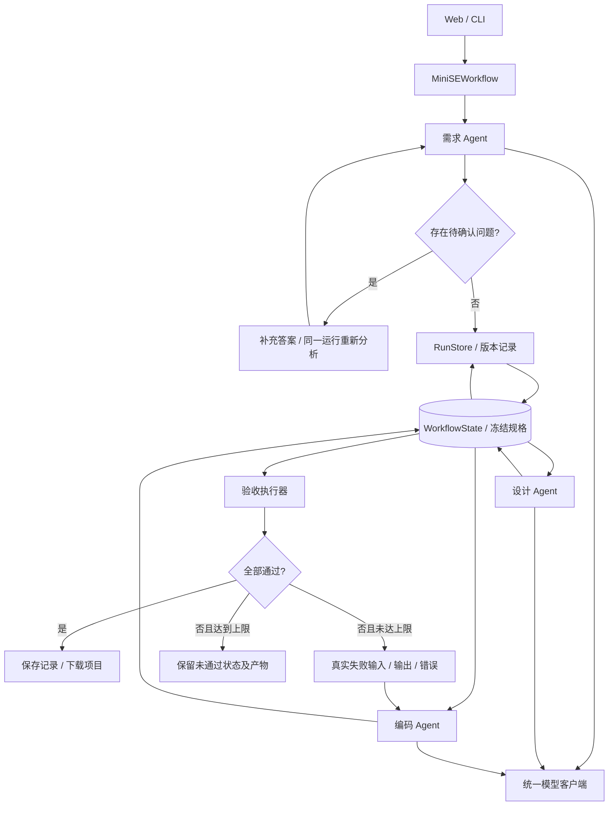
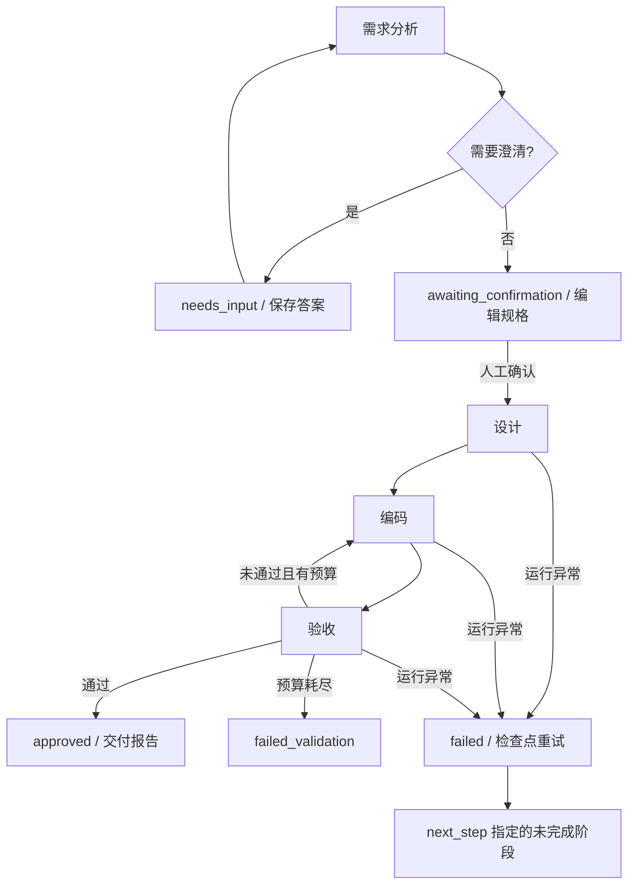

# 设计说明

## 目标

把自然语言需求变成可运行的小型 Python 项目，通过需求、设计、编码三个 Agent 的协作理解 Workflow 编排、状态共享和反馈控制。项目把“产物生成”和“验收通过”分成两个独立事实：是否通过由实际执行结果决定。

## 前置阶段可靠性改进

需求和设计的结构错误允许反馈给原节点纠正，默认每阶段最多2次，初次调用不计纠正；可配置为0关闭。只处理模型正文无效JSON、空正文、输出截断和明确的产物契约错误。鉴权、HTTP预算、网络故障及程序异常不触发格式纠正。传输重试、前置纠正和代码返工是三个独立预算。

每轮需求分析/设计的纠正次数、错误摘要、截断标志及候选正文片段保存在 `WorkflowState.planning`；纠正请求发出前即扣除并持久化预算，取消或恢复不重置。补充需求形成新的分析轮次。设计纠正始终使用冻结规格，不能放宽验收。达到上限明确失败并保留诊断，不补造关联编号或删除需求来通过校验。

需求提示优先合并同一业务的相关规则、用少量短用例覆盖全部需求；设计保持模块与接口精简。客户端显式识别 `finish_reason=length`，即使截断文本恰好能解析也拒绝交给下一节点；下一次要求重新输出完整且更简洁的对象，不拼接半截JSON。日常默认输出上限32768 token，可由 `LLM_MAX_TOKENS` 配置1024–65536；固定实验显式指定自己的上限。首轮16384上限下图书连续截断，单独提高预算后复测，不改写首轮结果。

分阶段验收：

1. 故障注入验证缺失覆盖、缺失文件、无效JSON和截断可纠正，错误反馈准确，确认规格不变；鉴权不纠正、耗尽停止、取消/恢复不重置预算。失败先修复再继续。
2. 完整测试、离线评测、代码差异/交付报告兼容通过；新增纠正记录可在界面日志和交付报告查看。
3. 固定任务开展有/无前置纠正的同期小样本实验，保持模型、提示、开发集、隐藏独立集、输出上限及代码返工相同，单独报告调用代价和全部失败。先记录次数与费用估算，不覆盖此前单/三Agent实验。

## 架构

Agent 不相互调用。Workflow 负责取出上一步的结果、检查格式、更新状态，再把数据交给下一个节点。三个 Agent 可以使用同一个模型客户端，但系统提示词、职责及输入上下文相互独立。

验收执行器是确定性的程序节点，不是第四个 Agent。它不能修改需求、设计或代码，只返回可观察的执行结果。

## Agent 数据约定

### 需求 Agent

输出 `project_name`、`summary`、`assumptions`、`questions`、`requirements` 和 `acceptance`。需求使用稳定编号，如 `R1`；验收用例通过 `requirement_ids` 指向需求，每条需求至少对应一个用例。

验收用例包含若干步骤，每步有 JSON `input` 和非空 `expected`。主程序规定每次请求都重新启动进程，方便通过同一目录中的数据验证跨进程持久化。

核心需求不明确或超出支持范围时，Agent 可返回 `questions`。Workflow 保存记录后切换到 `needs_input`，不会继续设计或编码。用户补充答案后继续同一运行，并再次检查需求。

### 设计 Agent

输出 `summary`、`files`、`interfaces` 和 `data_model`。每个文件说明职责并关联需求编号，必须包含 `main.py` 和 `README.md`。接口说明应明确输入输出字段与错误行为。

设计数据校验确保需求编号真实存在，全部需求被设计覆盖，文件名不存在重复或路径越界。

### 编码 Agent

读取固定的需求与设计，输出 `summary` 和以文件名为键的 `files`。输出必须完整包含设计文件，不能添加未设计文件或改变验收用例。

返工仍使用编码 Agent，额外输入 `previous_files` 和 `feedback`。格式不合规、无效JSON及截断的编码输出进入返工；传输/鉴权等模型调用失败则保存失败状态后结束。

## 状态共享和消息传递

`WorkflowState` 是单次运行的统一状态：

| 字段 | 含义 |
|---|---|
| `run_id`、`task`、`mode` | 运行标识、用户需求及模型模式 |
| `status`、`current_step` | 整体结果和当前步骤 |
| `specification`、`design` | 已校验的需求与设计 |
| `files` | 最近一次符合文件约定的完整项目 |
| `iterations` | 每版文件、生成摘要和验收报告 |
| `repair_count` | 已执行返工次数 |
| `messages` | 发送方、接收方、产物类型及摘要 |
| `events` | 步骤、状态、时间与执行信息 |
| `error` | 未恢复的运行异常 |

数据在交给 Agent 前进行深复制；验收用例在编码前复制固定。编码 Agent 返回值只读取代码与摘要，因此无法通过输出新用例来放宽验收条件。示例固定用例由程序额外加入，与需求 Agent 生成用例分开标记。

状态与验收记录保存到磁盘，Web 页面收到相同的状态快照。页面展示消息摘要与实际执行日志，不展示模型的隐藏推理内容。

## 流程与状态

1. 校验用户需求和示例标记，创建运行编号。
2. 执行需求 Agent；存在核心待确认问题时结束为 `needs_input`。
3. Web 默认暂停到 `awaiting_confirmation`，允许查看/修改并确认；CLI 默认自动确认，可用 `--review` 暂停。确认后固定验收用例，执行设计 Agent。
4. 执行编码 Agent，校验完整文件清单与文件大小。
5. 检查 Python 语法和支持范围，实际运行验收。
6. 全部通过则结束为 `approved`；未通过则携带真实失败反馈返工。
7. 默认最多执行两次返工（任务开始时可配置0–5次），依旧失败时结束为 `failed_validation`。
8. 未恢复的模型或文件错误结束为 `failed`，保存已完成阶段。

`approved` 表示通过当前验收集，不表示软件不存在其他缺陷。`failed_validation` 有可查看产物，但不会被界面误标为成功。

## 执行与验收

生成代码在独立临时目录中运行，子进程使用精简环境，避免把 API Key、PYTHONPATH 和主进程的其他环境变量传入。每步默认5秒，每轮默认60秒；持续输出超过64 KB 时中止进程。Windows 中止时尝试终止进程树。

源码使用 AST 和编译检查；标准库导入采取白名单，拒绝明显的动态执行、网络及子进程能力。这些检查限定教学项目范围，不构成可靠的安全沙箱；Python 代码仍拥有本机进程的文件权限，真正处理不可信生成代码需要额外的系统级隔离。

每个验收用例从干净项目开始，每个步骤重启进程。执行器记录输入、预期、实际 JSON、标准输出、错误输出、退出码和耗时。比较对象中指定的字段；数组精确比较长度及顺序，区分布尔值和数字。

验收通过需要源代码检查通过、所有用例通过且用例总数非零。超时、非JSON、错误退出码、缺少输出字段以及错误业务结果均产生失败反馈。

## Web 接口

| 接口 | 用途 |
|---|---|
| `GET /api/health` | 模型模式、示例需求和返工上限 |
| `POST /api/run` | 提交需求，立即返回202，后台执行 |
| `GET /api/status` | 当前状态和运行占用情况 |
| `GET /api/runs` | 最近50次运行摘要 |
| `GET /api/runs/<id>` | 查看历史完整状态 |
| `GET /api/download/<id>` | 下载最终有效项目及开发记录 |

服务监听 `127.0.0.1`，验证请求 Host 和 POST Origin，不提供跨站调用。单次运行使用互斥锁，重复提交返回409。模型结果通过 `textContent` 展示，生成文本不作为 HTML 执行。密钥只存在于模型客户端，不返回页面或 ZIP。

## 可扩展性

- 替换模型：实现 `complete_json` 接口即可；Agent 与 Workflow 无需改变。
- 新增 Agent：可以在设计后加入设计审查节点，在完成前加入文档或测试生成节点。
- 增强验证：为明确业务模板新增固定测试；加入更严格的类型或静态分析检查。
- 改进隔离：替换验收执行器中的进程启动方式，接入容器或专用低权限执行环境。
- 多目录项目：修改文件约定、路径校验、产物存储和本地导入策略后扩展。
- 人工检查：在需求与设计之后增加确认节点；当前版本支持需求确认、补充后继续同一任务，以及从检查点恢复。

首版保持线性主流程与有限返工循环，便于观察状态传递和进行端到端验证。

## 0.2 升级状态机与检查点

CLI与自动评测可显式采用自动执行模式；Web默认人工确认。`confirmed_specification` 保存冻结规格，`requirement_history`保存生成、修改和补充记录；`next_step`在节点成功后提交，`pending_artifact`保存尚未完成验收的代码。重启时只把持有进程已结束的 running 记录标为 interrupted；用户点击恢复后才继续调用模型。旧记录没有检查点，只能查看与下载。

取消使用线程事件，模型请求前后、验收步骤与子进程轮询中检查。取消时终止验收进程并保留检查点；模型HTTP响应不可立即撤回。取消发生在节点产物提交前，该节点恢复时会重做；系统提供节点级恢复，不承诺请求内部续跑。

新增接口：`POST /api/actions/<id>`，action 为 confirm（可带specification）、clarify（answer）、retry 或 cancel；恢复先取得运行锁，再校验、保存状态并后台执行。非法操作不写入记录，重复操作拒绝。`GET /api/diffs/<id>`返回实际版本差异；`GET /api/report/<id>`导出交付报告。生成文本继续使用textContent渲染。

修复预算固定在任务记录中；恢复不增加预算。网络调用失败重试与代码返工是不同机制，前者不会产生新的代码版本，仍可能消耗模型费用。差异以最后有效版本为基准，契约不合格的空版本不被解释成删除全部文件。

## 独立评测与持续验证

evaluation模块读取预先固定的套件，运行与Workflow验收分离的业务用例，并保存哈希、失败结果、实际服务usage和请求数量。项目必须自身验收与独立验收都通过才计成功；澄清任务要求needs_input且没有代码。自动检查不能判断澄清问题是否充分，需人工核对。

评测客户端可限制HTTP请求总数和输出token；无正文响应也记录服务usage。严格JSON拒绝NaN/Infinity。GitHub自动测试不调用模型，覆盖系统行为与故障注入；真实评测另行估算费用并记录，不把离线结果冒充生成能力。

独立评测完成后写入任务的 independent_evaluation，保留流程状态与独立评测成功标志两个不同事实。概览和交付报告同时展示两者；未评测时明确注明未执行独立评测。

## 2026-10-15：图书审查与实验控制

独立用例可以使用 `initial_files`、`initial_directories` 和每步 `preserve_files`，仅允许不覆盖项目源码的根目录JSON/TXT数据文件或其临时目录。全部夹具在执行前校验，拒绝路径越界和覆盖源文件；模型输出契约不会保留这些扩展字段。用例在独立临时目录初始化，每一步前后记录数据文件SHA256、字节数与存在类型，错误JSON响应不能掩盖文件变更。

library_audit同时复验原始8项和新增21项，区分原需求与补充质量规则。publish创建新run_id，明确human_reviewed来源；新规格冻结后，两版均按补充规格重新验收。原始运行不修改、不冒充自动返工。修订版沿用原始日期先后规则，区分缺失文件与损坏/不可读文件，异常不能重置库，写入以同目录临时文件替换。

comparison使用统一DevelopmentRunner，三Agent自产用例不作为实验评分依据；单Agent从同一原始任务直接生成代码，沿用同样的CodingAgent指令、文件契约、执行器和返工上限。三个固定任务、两次重复，交替执行先后。独立集最后运行，不回流修复。失败在指标分母中保留，配置、实现与套件哈希写入报告。此实验比较完整方案，不把结果简单归因于Agent数量，也不宣称小样本统计显著。
