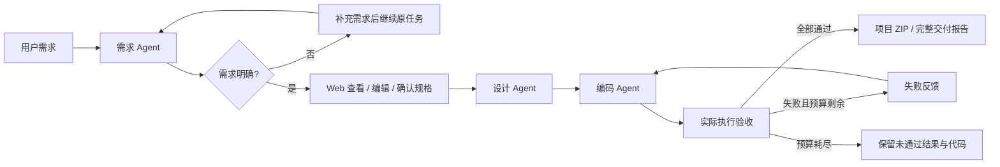

# Mini SE 工作流

[](https://github.com/Peanora/mini-se-workflow/actions/workflows/tests.yml)

软件工程第二次作业，选择 **Mini SE 流程**：需求、设计、编码三个 Agent 共享结构化状态，生成可运行的小型 Python 工具。验收执行器实际启动程序，把失败输入和输出交回编码 Agent 返工。Web 支持需求确认、历史记录、恢复、代码差异和项目交付。

**审查入口：[作业要求与证据对照](REVIEW.md)** · [设计与流程图](Design.md) · [详细使用说明](使用说明.md) · [提交清单](提交清单.md) · [一分钟演示](演示说明.md)

## 流程



CLI 默认自动执行，使用 `--review` 可在需求确认前暂停。返工默认最多两次，可配置 0–5 次；初稿不计返工。需求/设计契约错误与模型调用异常保存为失败，需检查或重试失败节点，不会自动进入编码返工循环。

## 克隆后立即验证：无需密钥

Python **3.10+**，从仓库根目录执行。运行时无第三方包，不需要安装依赖或配置模型。以下使用 `python`；Windows 也可将它替换为 `py -3`，Linux/macOS 可用 `python3`。

```sh
git clone https://github.com/Peanora/mini-se-workflow.git
cd mini-se-workflow
python -X utf8 -m mini_se_workflow.verification
```

一条命令顺序执行单元/集成测试、六项离线评测、离线单/三 Agent 对照和图书案例审查。返回 `0` 表示本轮检查均达到各自预期；失败返回 `1`。每次新建 `outputs/review/<时间-编号>/`，保留 `summary.json`、分项日志、JSON 结果及流程运行记录，不覆盖已提交的示例证据。通常需要约 1–3 分钟，以机器性能为准。

**离线核验只证明程序机制与固定样例的行为，不证明真实模型能力。** 图书原版的 12 项质量缺陷应当继续复现，不能为了全绿删除失败案例。文件位置和预期见 [REVIEW.md](REVIEW.md)。

## 打开界面

```sh
python -X utf8 -m mini_se_workflow --demo --web --open-browser
```

地址为 **http://127.0.0.1:8002**。Windows 也可双击 `启动离线演示.bat`。

1. 保留预置待办需求，点击“开始开发”，检查需求和验收条件。
2. 点击“确认并继续开发”，观察初稿 **7/9**、返工后 **9/9**。
3. 查看失败原因、协作记录、每版代码差异，下载项目和报告。

离线模式使用固定响应，只支持预置待办需求。验收仍实际执行生成程序。需要自由需求时复制 `.env.example` 为 `.env`，填写自己的密钥，再运行 `python -X utf8 -m mini_se_workflow --web --open-browser`；详见 [使用说明](使用说明.md)。不要将密钥提交到仓库或录入视频。付费评测先估算请求次数及费用，离线核验命令不会调用模型。

## 已完成什么

| 课程要求或增强项 | 当前实现 |
|---|---|
| 至少两个 Agent、完整顺序流程 | 三个 Agent，需求 → 设计 → 编码 → 实际验收 → 交付 |
| 消息传递或状态共享 | `WorkflowState`、消息摘要、逐阶段事件、磁盘检查点 |
| 条件与循环 | 需求澄清分支、验收分支、有预算返工循环 |
| 需求正确性 | Web 编辑/确认、需求编号追踪、冻结验收、补充后继续同一任务 |
| 错误处理 | 有限网络重试、失败节点重试、中断恢复、取消、预算不重置 |
| 结果可复核 | 代码差异、执行日志、ZIP、交付报告、独立评测及失败保留 |
| 持续验证 | Windows/Ubuntu × Python 3.10/3.13，CI 上传每项日志与结果 |
| 文档与扩展 | 流程图、架构和协议、新增节点/替换客户端说明、演示与提交指南 |

未实现并行调度或拖拽编排；页面是运行观察与人工确认界面。完整的要求—实现—测试映射见 [REVIEW.md](REVIEW.md)，不以此表代替实际核验。

## 实测结果与证据

| 证据 | 已记录结果 | 解释 |
|---|---|---|
| 自动化测试 | 58 项，覆盖执行器、工作流、恢复、Web、报告和核验入口 | 运行上方命令或查看 [CI](https://github.com/Peanora/mini-se-workflow/actions) 日志 |
| 离线流程与评测 | 待办 7/9 → 9/9；六项评测符合预期 | 固定响应，只验证机制 |
| 真实需求评测 | 首轮 3/6；定向复测 2/3 | [失败记录与口径](examples/评测说明.md)，不能拼成全通过 |
| 图书案例审查 | 原业务复核 9/9；新增质量检查原版 0/12、审查修订 12/12 | [原版/修订版与完整结果](examples/library-audit/审查说明.md)；修订由开发助手直接完成，不冒充流程自动返工 |
| 真实单/三 Agent 对照 | 单 Agent 5/6，三 Agent 1/6 | [报告](examples/comparison-real.md)、[原始 JSON](examples/comparison-real.json)、[全部运行归档](examples/comparison-real.zip)；小样本不能证明一般优劣 |

图书原始运行的 **8/8** 验收保持不变；新增要求单独计分，修订版独立检查为 **21/21**。保存的真实记录可审阅，重新调用模型不保证得到相同结果。

## 结构与边界

| 位置 | 职责 |
|---|---|
| `mini_se_workflow/agents.py`、`contracts.py` | 三个职责、数据契约和覆盖检查 |
| `workflow.py`、`models.py`、`store.py` | 编排、状态、检查点、版本和归档（位于包内） |
| `runner.py`、`llm.py` | 真实子进程验收、模型客户端（位于包内） |
| `web.py`、`static/index.html` | 本地界面与 API（位于包内） |
| `evaluation.py`、`comparison.py`、`library_audit.py`、`verification.py` | 独立评测、对照与离线核验（位于包内） |
| `tests/`、`examples/` | 测试、固定套件、真实与离线证据 |

当前生成目标是使用标准库、JSON 标准输入输出的小型本地 Python 工具，最多 10 个根目录文件。不支持联网工具、安装第三方依赖或任意框架。验收有临时目录、精简环境、时间和输出限制，**不构成操作系统级安全沙箱**。本地服务串行执行，不提供分布式锁；远端模型请求不能立即撤回。验收通过也不能保证需求无遗漏。

升级要求与阶段验收记录见 [项目进展](项目进展.md)，设计取舍和实验局限见 [答辩说明](答辩说明.md)。
