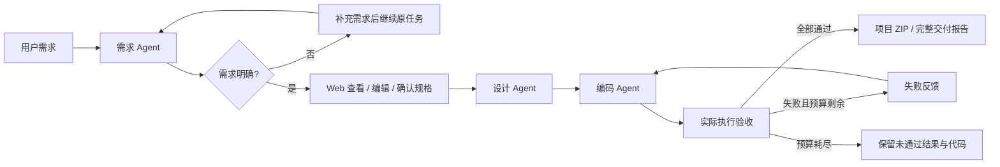

# Mini SE 工作流

[](https://github.com/Peanora/mini-se-workflow/actions/workflows/tests.yml)

Mini SE 是一个由需求、设计、编码三个 Agent 协作的开发工作流，将自然语言需求转换为可运行的小型 Python 工具。验收执行器实际启动程序，把失败输入和输出交回编码 Agent 返工。Web 支持需求确认、历史记录、恢复、代码差异和项目交付。

[使用说明](使用说明.md) · [架构设计](Design.md) · [评测说明](examples/评测说明.md)

## 流程



CLI 默认自动执行，使用 `--review` 可在需求确认前暂停。需求和设计输出不合规时，各允许最多两次纠正，可用 `--stage-corrections 0` 关闭；次数和错误保存在原任务，恢复不重置。代码返工默认最多两次，可配置 0–5 次；初稿不计返工。格式纠正、网络重试和代码返工分别计数，耗尽预算或遇到不可恢复错误时保留失败状态。

## 环境与安装

Python **3.10+**，运行时无第三方 Python 依赖，离线模式无需密钥。从仓库根目录执行以下命令；Windows 可用 `py -3` 代替 `python`，Linux/macOS 可用 `python3`。

```sh
git clone https://github.com/Peanora/mini-se-workflow.git
cd mini-se-workflow
```

## 打开界面

```sh
python -X utf8 -m mini_se_workflow --demo --web --open-browser
```

地址为 **http://127.0.0.1:8002**。Windows 也可双击 `启动离线演示.bat`。

1. 保留预置待办需求，点击“开始开发”，检查需求和验收条件。
2. 点击“确认并继续开发”，观察初稿 **7/9**、返工后 **9/9**。
3. 查看失败原因、协作记录、每版代码差异，下载项目和报告。

离线模式使用固定响应，只支持预置待办需求。验收仍实际执行生成程序。需要自由需求时复制 `.env.example` 为 `.env`，填写自己的密钥，再运行 `python -X utf8 -m mini_se_workflow --web --open-browser`；详见 [使用说明](使用说明.md)。`.env` 已被 Git 忽略。真实模型调用会产生费用，批量评测前应先估算请求次数和费用。

## 功能

| 功能 | 说明 |
|---|---|
| 开发流程 | 三个 Agent，需求 → 设计 → 编码 → 实际验收 → 交付 |
| 消息传递或状态共享 | `WorkflowState`、消息摘要、逐阶段事件、磁盘检查点 |
| 条件与循环 | 需求澄清分支、验收分支、有预算返工循环 |
| 需求正确性 | Web 编辑/确认、需求编号追踪、冻结验收、补充后继续同一任务 |
| 错误处理 | 有限网络重试、前置输出纠正、失败节点重试、中断恢复、取消、预算不重置 |
| 结果可复核 | 代码差异、执行日志、ZIP、交付报告、独立评测及失败保留 |
| 持续验证 | Windows/Ubuntu × Python 3.10/3.13，CI 上传每项日志与结果 |
| 模块扩展 | 模型客户端、Agent、验收执行器与状态存储分别定义 |

页面用于运行观察与人工确认，目前不支持并行调度或拖拽编排。

## 测试

```sh
python -X utf8 -m unittest discover -s tests -v
```

运行全部测试及离线评测：

```sh
python -X utf8 -m mini_se_workflow.verification
```

检查包括单元/集成测试、六项离线评测、单/三 Agent 离线对照和图书案例回归，均不调用模型。日志、JSON 结果和运行记录保存在 `outputs/verification/<时间-编号>/`。检查完成且全部符合预期时返回 `0`，失败或未完成不标记为通过。GitHub Actions 在 Windows/Ubuntu、Python 3.10/3.13 上运行相同检查并保存日志。

离线评测验证固定样例和流程机制，不代表真实模型能力。图书原版的质量缺陷作为回归案例保留，原版独立检查预期为 9/21，修订版为 21/21。

## 评测结果

| 类型 | 结果 | 说明 |
|---|---|---|
| 自动化测试 | 71 项，覆盖执行器、工作流、前置纠正、恢复、Web、报告和实验隔离 | 运行上方命令或查看 [CI](https://github.com/Peanora/mini-se-workflow/actions) 日志 |
| 离线流程与评测 | 待办 7/9 → 9/9；六项评测符合预期 | 固定响应，只验证机制 |
| 真实需求评测 | 首轮 3/6；定向复测 2/3 | [失败记录与口径](examples/评测说明.md)，不能拼成全通过 |
| 图书案例审查 | 原业务复核 9/9；新增质量检查原版 0/12、审查修订 12/12 | [原版/修订版与完整结果](examples/library-audit/审查说明.md)；修订由开发助手在工作流外完成 |
| 真实单/三 Agent 对照（前置纠正改进前） | 单 Agent 5/6，三 Agent 1/6 | [报告](examples/comparison-real.md)、[原始 JSON](examples/comparison-real.json)、[全部运行归档](examples/comparison-real.zip)；小样本不能证明一般优劣 |
| 前置纠正同期实验 | 关闭2/3、开启2/3 | [报告](examples/reliability-real.md)、[原始JSON](examples/reliability-real.json)、[归档](examples/reliability-real.zip)；观察到设计JSON纠正成功，图书仍因16384上限连续截断 |

图书原始运行的 **8/8** 验收保持不变；新增要求单独计分，修订版独立检查为 **21/21**。保存的真实记录可审阅，重新调用模型不保证得到相同结果。

## 结构与边界

| 位置 | 职责 |
|---|---|
| `mini_se_workflow/agents.py`、`contracts.py` | 三个职责、数据契约和覆盖检查 |
| `workflow.py`、`models.py`、`store.py` | 编排、状态、检查点、版本和归档（位于包内） |
| `runner.py`、`llm.py` | 真实子进程验收、模型客户端（位于包内） |
| `web.py`、`static/index.html` | 本地界面与 API（位于包内） |
| `evaluation.py`、`comparison.py`、`library_audit.py`、`verification.py` | 独立评测、对照与离线核验（位于包内） |
| `tests/`、`examples/` | 测试、固定套件、真实与离线运行记录 |

当前生成目标是使用标准库、JSON 标准输入输出的小型本地 Python 工具，最多 10 个根目录文件。不支持联网工具、安装第三方依赖或任意框架。验收有临时目录、精简环境、时间和输出限制，**不构成操作系统级安全沙箱**。本地服务串行执行，不提供分布式锁；远端模型请求不能立即撤回。验收通过也不能保证需求无遗漏。

架构、状态与扩展方式见 [Design.md](Design.md)，实验设置和局限见 [单 Agent 对照方案](examples/单Agent对照方案.md)、[实验报告](examples/comparison-real.md) 与 [前置纠正实验方案](examples/前置纠正实验方案.md)。
